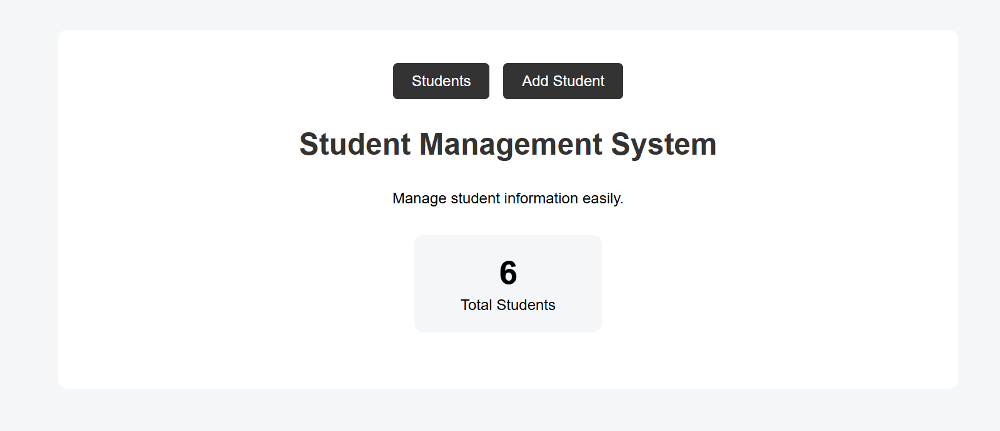
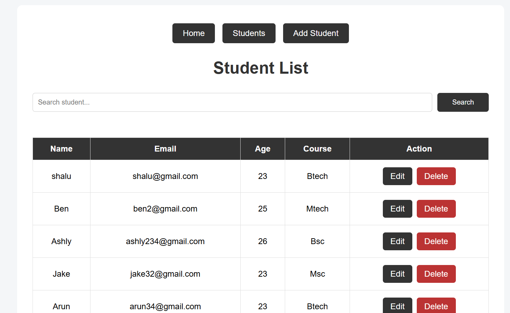
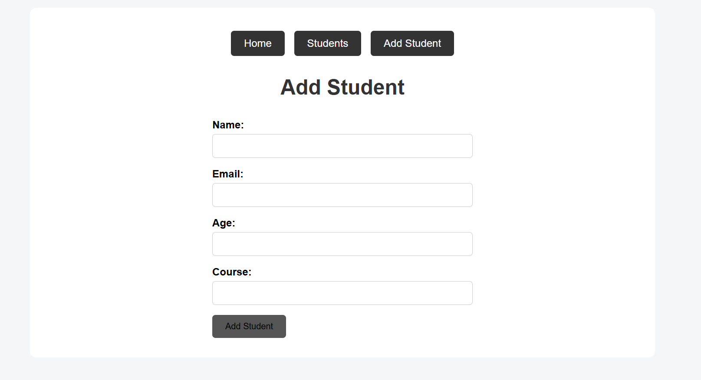
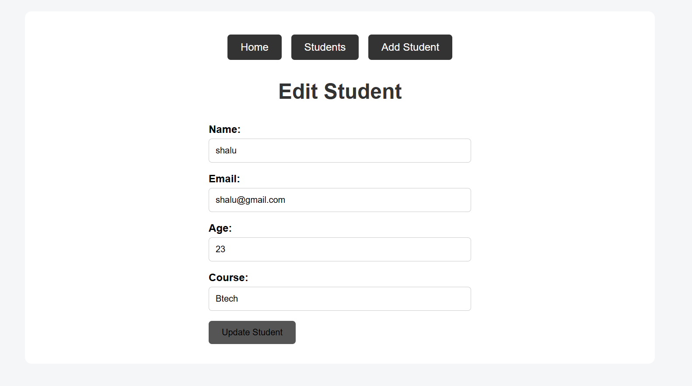

# Student Management System

A simple web-based Student Management System developed using Python and Django.

## Features

- Add new students
- View all students
- Search students by name
- Edit and update student details
- Delete students
- Form validation
- Success messages for add, update, and delete operations

## Technologies Used

* Python
* Django
* SQLite
* HTML
* CSS
* Django ORM

## CRUD Operations

* **Create** – Add student
* **Read** – View and search students
* **Update** – Edit student details
* **Delete** – Remove students

## Project Structure

```text
student_manager/
│
├── student_manager/
│   ├── settings.py
│   ├── urls.py
│   ├── asgi.py
│   └── wsgi.py
│
├── students/
│   ├── migrations/
│   ├── templates/
│   ├── static/
│   ├── admin.py
│   ├── apps.py
│   ├── models.py
│   └── views.py
│
├── manage.py
├── requirements.txt
├── README.md
└── .gitignore
```

## How to Run

1. Clone the repository.
2. Create and activate a virtual environment.
3. Install the required packages:

```bash
pip install -r requirements.txt
```

4. Apply database migrations:

```bash
python manage.py migrate
```

5. Start the Django development server:

```bash
python manage.py runserver
```

6. Open the local URL shown in the terminal.

## Screenshots

### Home Page



### Student List



### Add Student



### Edit Student



